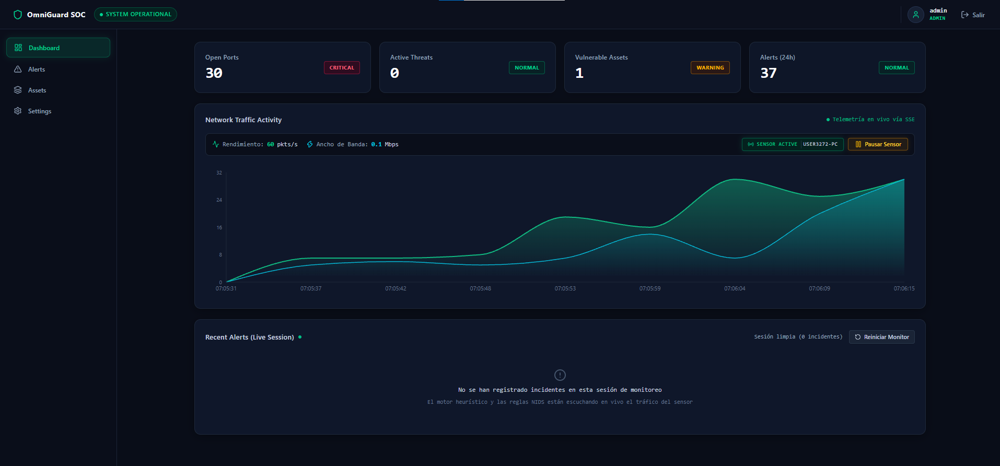

# OmniGuard SOC — Consola de Mando Web Blue Team

<div align="center">
  
  <h3>Plataforma Distribuida de Ciberseguridad Defensiva y Alerta Temprana</h3>
  <p>Single Page Application (SPA) para Operadores de Seguridad, Telemetría Forense y Monitoreo Reactivo</p>
</div>

---

## 1. Resumen Ejecutivo y Propósito

El módulo `omniguard-frontend-react` constituye la interfaz web interactiva de OmniGuard SOC. Diseñada específicamente para analistas de centros de operaciones de seguridad (*Blue Team*), provee un entorno centralizado y reactivo para la supervisión de telemetría de red, la evaluación forense de incidentes detectados, el inventario de activos de infraestructura y la configuración de canales de respuesta.

La aplicación está construida sobre **React 19**, **TypeScript** y **Vite**, complementada con una arquitectura de estilos modular basada en **Tailwind CSS v4** con diseño *SOC Dark Theme*. Su principio de diseño fundamental es la seguridad de grado corporativo: la aplicación implementa una política estricta de **cero almacenamiento de credenciales en el cliente** (*Zero-Token Storage*), operando exclusivamente a través de cookies criptográficas `HttpOnly` emitidas por el backend transaccional.

---

## 2. Vista Previa de la Interfaz

<div align="center">
  
  <p><em>Consola de mando y autenticación protegida del ecosistema OmniGuard SOC.</em></p>
</div>

---

## 3. Stack Tecnológico y Selección Arquitectónica

* **Framework Base:** React 19 (Functional Components, Hooks modernos, concurrencia nativa).
* **Tipado Estático:** TypeScript en modo estricto (`strict: true`), garantizando solidez en contratos de datos y eliminación de errores en tiempo de compilación.
* **Herramienta de Construcción:** Vite 8 (Hot Module Replacement instantáneo, optimización de bundles con Rollup).
* **Motor de Estilos:** Tailwind CSS v4, complementado con variables CSS personalizadas y diseño adaptativo oscuro de alta legibilidad para turnos de monitoreo prolongados.
* **Gestión de Estado Global:** Zustand (almacenamiento en memoria volátil de sesión y perfil de operador, sin contacto con APIs persistentes de navegador).
* **Sincronización de Datos y Caché:** TanStack Query v5 (React Query), gestionando deduplicación de peticiones, políticas de reintentos, invalidación de consultas y caché fresca de telemetría.
* **Tablas de Alta Densidad:** TanStack Table, optimizada para paginación, ordenamiento multinivel y filtrado de grandes volúmenes de alertas de red.
* **Visualización de Telemetría:** Recharts, configurada para gráficos de series de tiempo de paquetes por segundo y distribución de protocolos.
* **Iconografía Técnica:** Lucide React.

---

## 4. Arquitectura de Seguridad en el Navegador

La consola web aplica medidas preventivas rigurosas contra los principales vectores de ataque dirigidos a aplicaciones SPA:

### 4.1. Inmunización Total contra XSS y Session Hijacking
A diferencia de arquitecturas tradicionales que guardan tokens JWT en `localStorage` o `sessionStorage` (haciéndolos susceptibles a exfiltración ante cualquier inyección de script por dependencias de terceros), OmniGuard adopta **Zero-Token Storage**:
* Los tokens de sesión PASETO v4 residen única y exclusivamente en cookies marcadas con las directivas `HttpOnly`, `SameSite=Strict` y `Secure`.
* El entorno JavaScript de React carece deliberadamente de acceso a las claves de sesión; el navegador adjunta automáticamente las credenciales en cada petición HTTP hacia la API mediante `credentials: 'include'`.

### 4.2. Verificación Silenciosa de Sesión y Protección de Rutas
* **`ProtectedRoute`:** Envoltura declarativa que intercepta la navegación hacia módulos sensibles, redirigiendo automáticamente a `/login` ante sesiones revocadas o no autenticadas.
* **Verificación de Entrada:** Al cargar la aplicación, el almacén de autenticación (`useAuthStore`) invoca el endpoint seguro `/api/v1/auth/me`. Si el backend valida la cookie `at` activa, el operador accede inmediatamente a la consola sin reingresar credenciales.

---

## 5. Módulos y Vistas Principales

### 5.1. Módulo de Autenticación (`/login`)
Formulario de acceso con diseño SOC Dark Theme, validación de campos en tiempo real, bloqueo temporal ante intentos reiterados y retroalimentación formal de errores comunicados por el backend.

### 5.2. Tablero de Control de Mando (`/dashboard`)
* **Tarjetas de KPIs:** Cuatro indicadores principales de telemetría: Total de Alertas Registradas, Incidentes Críticos Activos, Activos en Red Descubiertos y Tasa de Tráfico Promedio.
* **Gráfica de Tráfico de Red:** Representación temporal de flujo de paquetes capturados por los sensores C++, desagregados por protocolos TCP, UDP e ICMP.
* **Tabla de Incidentes Recientes:** Vista resumida de las últimas detecciones heurísticas con codificación de severidad por colores estandarizados.

### 5.3. Consola Forense de Incidentes (`/alerts`)
* Listado tabular interactivo con filtros dinámicos por severidad (`BAJA`, `MEDIA`, `ALTA`, `CRITICA`) y estado (`ABIERTA`, `INVESTIGANDO`, `RESUELTA`).
* Modal de inspección forense detallada que expone la tupla de conexión, banderas TCP involucradas, marcas de tiempo de microsegundos y payload crudo asociado.
* Transición de estado del incidente en tiempo real mediante peticiones `PATCH`.

### 5.4. Inventario de Activos y Vulnerabilidades (`/assets`)
* Catálogo de nodos descubiertos pasivamente en la infraestructura local.
* Detalle expandible de puertos abiertos, servicios deducidos (SSH, HTTP, Bases de Datos) y cadenas CPE identificadas.
* Visualización directa de vulnerabilidades correlacionadas (CVEs) con enlace al catálogo oficial del NIST NVD y su respectiva puntuación CVSS.
* Disparo manual de auditorías activas bajo demanda mediante llamada al motor de escaneo.

### 5.5. Configuración de Operaciones (`/settings`)
* Gestión de canales de notificación externa (configuración y prueba de Webhooks de Discord y parámetros de Bot de Telegram).
* Parámetros de umbrales del sistema y consulta de versiones de los microservicios componentes.

---

## 6. Integración en Tiempo Real con Server-Sent Events (SSE)

La consola implementa un hook personalizado (`useAlertStream`) que se suscribe al flujo de eventos del backend en `/api/v1/alerts/stream`:
1. Mantiene una conexión unidireccional persistente sobre HTTP/2.
2. Cada vez que el motor de análisis en Python detecta una anomalía de red, la alerta llega de inmediato a la interfaz sin necesidad de encuestas continuas (*polling*).
3. Invalida selectivamente las consultas activas en TanStack Query, actualizando los contadores de los KPIs y añadiendo la fila de incidente con efectos visuales sutiles sin recargar la página.

---

## 7. Variables de Entorno y Configuración

El archivo `.env` permite definir los destinos de red para los entornos de desarrollo y producción:

| Variable | Tipo | Valor Predeterminado | Descripción |
| :--- | :--- | :--- | :--- |
| `VITE_API_BASE_URL` | String | `http://localhost:8080` | URL base de la API REST del Core Java. |
| `VITE_SSE_STREAM_URL` | String | `http://localhost:8080/api/v1/alerts/stream` | URL del endpoint de transmisión Server-Sent Events. |

---

## 8. Estructura del Código Fuente

```
omniguard-frontend-react/
├── logo.png                          # Logotipo estandarizado del repositorio
├── preview.png                       # Vista previa de la interfaz en resolución HD
├── index.html                        # Punto de entrada HTML5 con metadatos de seguridad
├── package.json                      # Especificación de dependencias y scripts de construcción
├── vite.config.ts                    # Configuración del bundler Vite y resolución de alias (@)
├── tsconfig.json                     # Parámetros del compilador de TypeScript
├── nginx.conf                        # Configuración optimizada de servidor web para producción
├── Dockerfile                        # Empaquetado en contenedor ligero Alpine Nginx
└── src/
    ├── main.tsx                      # Inicialización del árbol de componentes React 19
    ├── App.tsx                       # Configuración de proveedores (QueryClient, Router)
    ├── assets/                       # Recursos gráficos locales
    ├── components/
    │   └── common/                   # Componentes transversales (Header, Sidebar, ProtectedRoute)
    ├── hooks/                        # Hooks personalizados (useAlertStream, useDashboardStats)
    ├── layouts/                      # Plantillas estructurales de la consola (MainLayout)
    ├── routes/                       # Definición de rutas públicas y protegidas (AppRoutes)
    ├── services/                     # Clientes de consumo HTTP (Axios / Fetch configurados)
    ├── store/                        # Almacenes de estado global Zustand (useAuthStore)
    ├── types/                        # Definiciones de tipos e interfaces TypeScript
    ├── utils/                        # Funciones auxiliares y formateadores de tiempo
    └── views/                        # Vistas completas de la aplicación
        ├── Login/                    # Pantalla de acceso al sistema
        ├── Dashboard/                # Tablero de telemetría y KPIs
        ├── Alerts/                   # Consola forense de incidentes
        ├── Assets/                   # Inventario de activos y correlación CVE
        └── Settings/                 # Parámetros de notificación y operación
```

---

## 9. Instrucciones de Construcción y Ejecución Local

### 9.1. Instalación de Dependencias
```powershell
npm install
```

### 9.2. Ejecución en Modo de Desarrollo
```powershell
npm run dev
```
La aplicación iniciará en `http://localhost:5173`.

### 9.3. Verificación de Tipos y Compilación de Producción
```powershell
npm run build
```
Genera la compilación minimizada y optimizada para producción en el directorio `dist/`.

---

## 10. Despliegue en Contenedores con Nginx

Para servir la aplicación en entornos productivos con manejo de rutas SPA y encabezados de seguridad:

```powershell
# Compilación de la imagen
docker build -t omniguard-frontend-react:1.0 .

# Ejecución del contenedor
docker run -d \
  --name omniguard-frontend \
  -p 80:80 \
  omniguard-frontend-react:1.0
```
